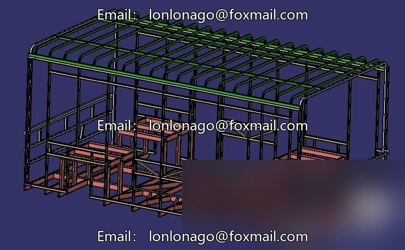
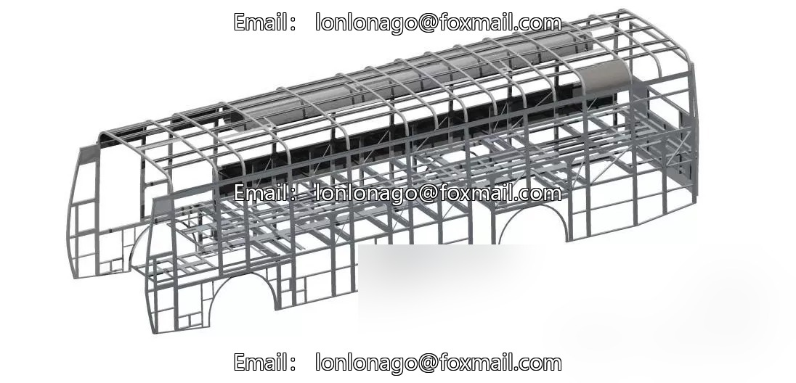
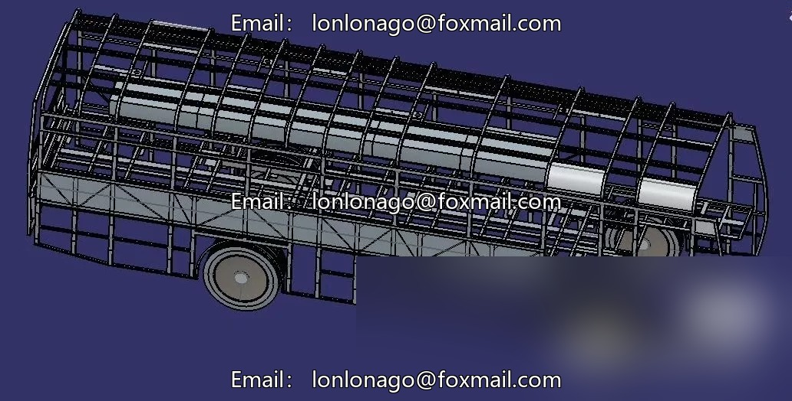
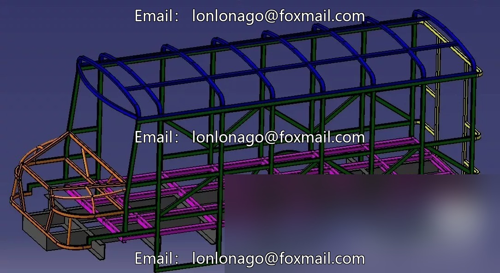

# Body frame 3D design drawing customization

## Body

Body frame 3D design drawing custom body design, frame design, body frame design, passenger vehicle body frame model and 3D, large passenger vehicle body frame, bus body frame 3D, body frame 3D diagram, school bus body frame, body frame design drawing, sedan body frame design.
Multiple models, can be opened and edited with tools such as CATIA UG SolidWorks, and can be designed according to your requirements.
There are other various 3D drawings for A007, and services such as modeling and model and 3D modification, etc. Please discuss in detail according to your requirements.

The image content is empty; based on the title and body, customization offers 3D design for car body skeletons including passenger, bus, bus, bus, school bus and sedan categories, along with modeling and parameter modification services.

<!-- AI_ENRICHED -->

## Images

## Payment

Here is a pay link on Stripe ( https://buy.stripe.com/3cs8yP7sY87d0vu9AB ). Please contact me lonlonago@foxmail.com after funding $89, and I will send you a complete data files , thank you!

